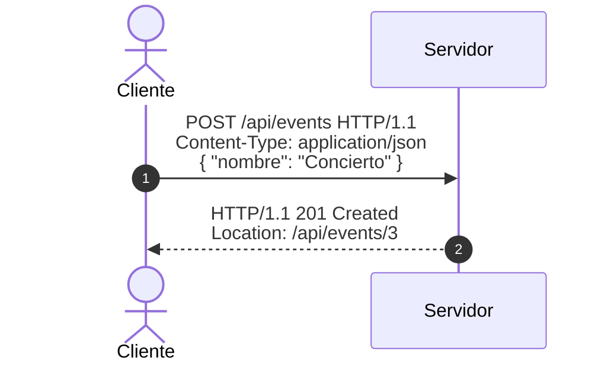

# Modelo mental

HTTP es un protocolo de aplicación que permite intercambiar mensajes entre un cliente y un servidor. El cliente envía una **solicitud** y el servidor devuelve una **respuesta**. Cada mensaje contiene una línea inicial, headers, una línea vacía y, cuando aplica, un cuerpo.

Una solicitud no es una función ni una llamada directa al servidor. Es un mensaje que viaja por una conexión y describe qué recurso quiere operar el cliente.
