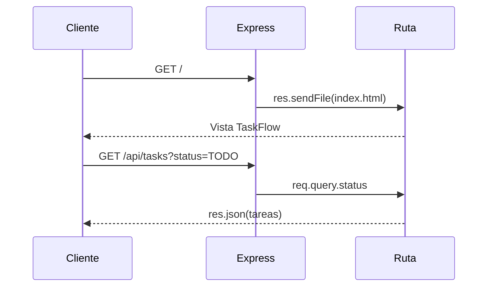

# Práctica guiada S19: Express - rutas

## Objetivo

Extender TaskFlow con rutas Express que entregan la vista inicial mediante `res.sendFile()`, publican recursos bajo `/assets` y leen parámetros, query strings y body JSON.

## Modelo mental

